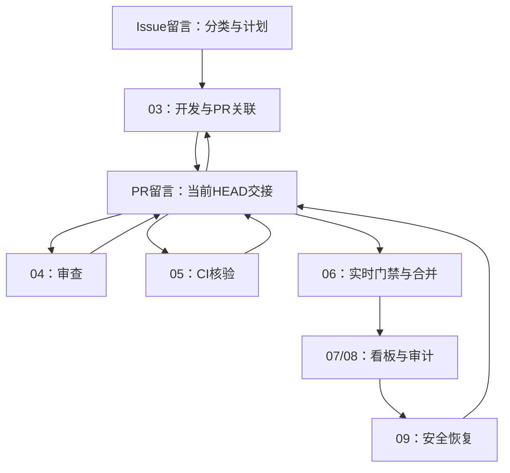

# DeepSeek Harness 定时任务职责与交接

## 原生定时任务范围

01至09是9个DeepSeek Harness原生定时任务，各自轮询Issue/PR普通留言。10/11是08同一轮中的记录职责，agent-dispatcher是03内部规则，不是新增执行者。周期见[清单](scheduled-task-overview.md)，共同配置见[安装](installation.md)。

箭头表示下轮读取合法留言并核验，不表示即时API调用或启动其他Agent。01/02的输出在Issue，03双向关联PR；07/08/09也在原业务对象追加各自结果。全局健康异常仅发已配置且授权的管理Issue。

| 任务 | 周期 | 读取 | 追加留言与权限 |
|---|---|---|---|
| 01巡检 | 30分钟 | 真实Issue、依赖与已有交接 | Issue分类；不认领、不开发 |
| 02规划 | 30分钟 | 01分类与有效计划链 | Issue完整PLAN_READY；不写源码 |
| 03开发 | 10分钟 | Issue计划、PR审查/CI/恢复 | 开始、检查点、PR关联、代码更新；独占源码/测试分支 |
| 04审查 | 15分钟 | 计划、当前Diff、CI和正式Review | PR REVIEW_RESULT；不改代码、不合并 |
| 05CI守护 | 10分钟 | 当前HEAD的全部CI与预算链 | PR CI_RESULT；仅有限授权重跑，不改CI/源码 |
| 06合并控制 | 10分钟 | 审查/CI留言并重读全部实时门禁 | PR MERGE_RESULT；唯一合并者，须已有授权 |
| 07看板 | 30分钟 | 业务交接与真实验收 | 既有自动化字段及同步结果；看板不是工作指令 |
| 08观察与记录 | 30分钟 | 全部合法交接、实际运行及评价证据 | 健康/验收/文档结果；按10/11维护指定两文件 |
| 09恢复 | 30分钟 | 08异常与实际停止/互斥证据 | 恢复结果；不开发、不重跑、不合并 |

## 版本与失败闭环

03等待CI/Review时在留言保存检查点并结束，上轮仍运行时不重复启动。05轮询失败并在PR发布诊断，03下一轮读取并续接原分支。新HEAD使旧成功失效；最新CI重跑使旧attempt不能通过门禁。02的计划更新须按前序链递增，需求依据变化时停止旧计划的新写入。

同根因修复、重跑和恢复预算沿留言链跨HEAD累计。结果未知先对账真实动作再补记，不能重复创建PR或覆盖分支。详细字段、允许类型、去重、编辑/缺失/冲突及接收算法见[留言协议](communication-protocol.md)。

## 并发、记录与关闭

留言不构成锁，也不能证明同账号下的实际角色身份。原生互斥须实际核验；不能证明唯一写入者时阻塞对应写入，09只有确认原负责者停止且安全移交后才能恢复。

08顺序读取10/11职责，在已有授权内维护test-cases.md与issue-log.md。其文档PR链接通过原业务对象的留言回传，文件不作交接队列。文档写入例外不扩大到其他仓库源码、CI、文档PR自动合并或故障Issue创建。

本集合不自动关闭Issue。08提供全量/部分验收事实，既有明确授权的关闭流程另行复核；父Issue部分交付保持开放。当前文档不等于实际安装、通信演练通过或运行验收完成。
